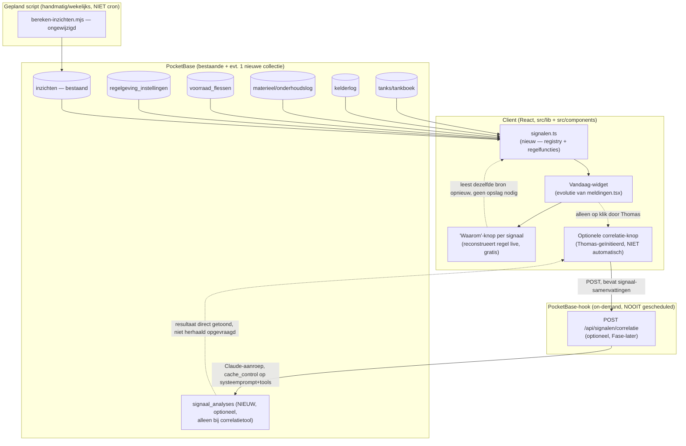

# Fase 10 — Proactieve assistent: Fase 1, Architectuur

> **Correctie (Fase 16, 28 augustus 2026):** waar dit document "producent"
> schrijft, heet dat vanaf Fase 16 **eigenaar** (collectie `eigenaars`, veld
> `eigenaar`). De term is gewijzigd omdat De Tappenmars ook voor andere
> wijngaarden en fruittelers verwerkt en bottelt; die klanten zijn geen
> producent maar eigenaar van hun eigen product. De tekst hieronder blijft
> staan zoals hij destijds is geschreven.

**Status: concept, wacht op akkoord van Thomas. Geen code, schema of data aangepast tijdens het opstellen van dit document.**

---

## 1a. Nulmeting — wat bestaat er al?

Onderzocht via statische code-analyse, geen wijzigingen aangebracht.

### `inzichten`-collectie

Schema in `scripts/setup-pocketbase.mjs` (regel 1361-1379): `inzicht_type` (select), `onderwerp`, `periode`, `berekend_op`, `waarde` (json), `samenvatting_nl`, `deleted`. **Uniek onder de agent-collecties**: rechten staan op `AUTH_RULE`, niet `OPEN_RULE` — login is vereist om te lezen.

Zes toegestane types (`INZICHT_TYPES`), maar `scripts/bereken-inzichten.mjs` berekent er **vijf**: `brix_verloop`, `gisting_snelheid` (stagnatie bij <0,5 °Oe/dag over ≥3 dagen), `uitval_cluster`, `gdd_afwijking` (via de gratis Open-Meteo archive-API), `fenologie_vergelijking`. `spuit_effectiviteit` staat in het schema maar heeft **geen** berekeningsfunctie — dode schema-entry.

Uitvoering: **puur handmatig**, geen cron. `CLAUDE.md` bevestigt het letterlijk: *"Draait handmatig, wekelijks op deze Windows-devmachine (...) — pas als de Raspberry Pi productiebackend live is, wordt dit een cron/systemd-timer."* Ter vergelijking: PocketBase zelf en de backup draaien al wél als Taakplanner-taak — de inzichtenberekening bewust niet.

Gebruik: `meldingen.tsx` haalt alle inzichten op en filtert client-side op `KRITIEKE_INZICHTEN = {gisting_snelheid, uitval_cluster}` (max. 5 getoond). De AI-agent kan ze los opvragen via de leestool `zoek_inzichten` en citeert ze in lopende tekst.

### Dashboardmeldingen (Fase 7 Blok B) — `src/components/meldingen.tsx`

Gerenderd op de hub (`/`). Vijf onafhankelijke bronnen, elk een eigen `useQuery`:

1. Kritieke inzichten (zie boven), max. 5.
2. AGP-drempel: melding al bij **80%** van `agp_drempel_liters_per_jaar`.
3. Onderhoud binnen 30 dagen (`onderhoudBinnenkort()`).
4. Backup-waarschuwing: `regelgeving_instellingen`-sleutel `"laatste_backup"`, ouder dan 2 dagen.
5. Kelderlog-taken: elke regel waarvan `notitie` begint met `"TAAK:"`, binnen 7 dagen of al verstreken.

**Bevinding, geen mening**: punt 4 (backup-waarschuwing) is een **tweede, onafhankelijke implementatie** van exact dezelfde check als `BackupWidget` op `src/routes/index.tsx` — beide lezen dezelfde sleutel, los van elkaar berekend, licht uit de pas kunnen lopen. Dit is precies het soort duplicatie dat ontstaat zonder een gedeelde signaal-laag, en dus een concreet argument vóór (een lichte vorm van) bundeling, niet een hypothetisch risico.

Afvinken: localStorage-sleutel `wg.meldingen.afgevinkt.v1`, permanent per stabiel id (bv. `onderhoud-${materieel}-${volgende_keer}`). **Geen snooze-met-vervaldatum**, geen globaal plafond (wel een deelplafond van 5 op inzichten). **Geen automatische herberekening** — alleen bij het (opnieuw) mounten van de hub-route, binnen de globale 30s-staleTime.

### `advies_feedback`

Wordt **daadwerkelijk gelezen door de agent**, niet alleen opgeslagen: tool `zoek_advies_feedback` (`agent_uitvoering.js`) zoekt eerdere berichten over een onderwerp en haalt het bijbehorende oordeel (klopte/klopte niet/deels) op, zodat de agent "zijn eigen trackrecord" kent. Schrijven gebeurt via 3 duim-knoppen onder elk assistant-bericht (niet-persistent uitgeschakeld na klikken — na page-reload weer klikbaar). Geen dashboard/statistiekoverzicht van feedback.

### Bestaande deterministische signalen

| Signaal | Waar de logica leeft | Al in UI? | Regel/AI |
|---|---|---|---|
| Onderhoud <30 dagen | `materieel-data.ts`, `onderhoudBinnenkort()` | Ja (2×) | Regel |
| Backup-waarschuwing | `backup-pocketbase.ps1` schrijft, 2× onafhankelijk gelezen (zie boven) | Ja (2×) | Regel |
| AGP-drempel (80%) | `kelder.accijns.tsx` + `meldingen.tsx` | Ja (2×) | Regel |
| Gistingsstagnatie | `bereken-inzichten.mjs`, wekelijks/handmatig | Ja | Regel (statistische drempel, expliciet "geen ML") |
| SO₂-/gistvoeding-nameting | `calculators-sectie.tsx` plant een kelderlog-`"TAAK:"`-regel | Ja | Regel |
| **Voorraad bijna op** | **Bestaat niet** — geen drempelveld, geen signaal | Nee | — |

### Werkorders/taakplanning

**Bestaat niet als apart datamodel.** `WERKLOG.md` stelt dit al vast in een eerdere nulmeting ("Geen werkorders, geen inkopen-collectie, geen blend-calculator gevonden"). Het bestand `mega-prompt-v2.md` bestaat niet in deze repository. De enige "taak"-vorm is de kelderlog-`"TAAK:"`-tekstconventie — een prefix-hack op een vrij-tekstveld, geen eigen entiteit met status/toewijzing/vervaldatum. (`werkrapport.tsx`'s `TaakType` is urenregistratie, geen taakplanning — niet verwarren.)

### Bronvermelding onder agent-antwoorden

Client-side opgebouwd (`bouwBronnenregel()` in `agent-data.ts`) uit de al opgeslagen `tool_calls`/`tool_resultaten`-velden op elk bericht — geen extra aanroep nodig. Levert bv. `"gebaseerd op: 12 metingen, inzicht gisting_snelheid W27"`.

### Prompt caching

**Al actief**, maar alleen op de systeemprompt (`cache_control: { type: "ephemeral" }` op het statische systeemprompt-blok in `agent_uitvoering.js`). Niet op de `tools`-array (30 tools, elke beurt opnieuw verstuurd) en niet op de berichtengeschiedenis.

### `agent_acties` / bevestigingspatroon

Volledig werkend patroon: voorstel (`status: "voorgesteld"`) → mens bevestigt/wijst af → server voert uit via bestaande atomische endpoints. Schrijfrechten op de collectie zelf staan op `null` (alleen hook-context mag schrijven).

**Bevinding, relevant voor dit ontwerp, los van de proactieve assistent**: de backend kent 9 `actie_type`-waarden inclusief `onderhoud` en `order`, maar de frontend-config (`AGENT_ACTIE_CONFIG` in `types.ts`) kent er maar 7 — mist precies deze twee. Als de agent ooit een `onderhoud`- of `order`-voorstel doet, heeft de bevestigingskaart geen weergaveconfiguratie. Dit is een bestaande bug, onafhankelijk van Fase 10, maar relevant omdat dit ontwerp diezelfde `agent_acties`-flow wil hergebruiken voor "signaal → taak promoveren" (zie 1b.3). **Aanbeveling: apart oppakken, buiten deze fase.**

---

## 1b. Weerwoord op de opdracht

### 1. Te vroeg?

**Ja, voor een deel — en de nulmeting bewijst het.** Er is precies één automatisch draaiend "proactief" mechanisme in de hele app: de inzichtenberekening, en die draait **handmatig, wekelijks, op een machine die 's nachts niet aanstaat** (bevestigd deze week nog in Fase 9: de nachtelijke tank-consistentiecheck-cron heeft in 5 dagen retentie nul keer gevuurd). Elk ontwerp dat veronderstelt dat er straks betrouwbaar en op tijd signalen binnenkomen, ontwerpt tegen een fundament dat dat vandaag niet waarmaakt.

Tegelijk: een deel van dit ontwerp hoeft niet te wachten, want het lost een **al aangetoond** probleem op, geen hypothetisch probleem. De backup-waarschuwing staat nu letterlijk twee keer onafhankelijk geïmplementeerd. Vijf `useQuery`-blokken in `meldingen.tsx` groeien ongestructureerd. Dat is vandaag al pijn, niet pas na een seizoen.

**Concreet voorstel — nu bouwen:**
- De regelgebaseerde signaallaag (Fase 2-4 hieronder): één gedeeld contract, één plek waar backup/onderhoud/AGP/taken/nieuwe voorraad-signalen samenkomen, met ontdubbeling en een plafond. Dit vervangt en verbetert `meldingen.tsx`, kost niets aan API-budget (puur databasequeries), en is per definitie nooit "te vroeg" — het ruimt op wat er al is.
- Eén nieuw, echt ontbrekend regel-signaal: voorraad-bijna-op (drempel op `voorraad_flessen`).

**Concreet voorstel — expliciet uitstellen tot na oogst 2026:**
- Elke vorm van AI-*synthese* over meerdere signalen heen (zie punt 2 hieronder — die vraag beantwoordt zichzelf al negatief op basis van verwacht volume, dus dit hoeft niet eens op data te wachten om te schrappen).
- Een eventuele AI-correlatietool ("waarom gebeurt dit allemaal") — deze *kan* wel pas echt beoordeeld worden na een seizoen met echte gelijktijdige signalen. Bouw het contract er wel alvast losjes voor open (zie 1c), maar implementeer het pas als er bewijs is dat het nodig is.
- De 03:00-cron-aanname voor "wanneer wordt een signaal berekend" — blijf bij handmatig/on-demand tot de Pi/VPS-migratie een machine oplevert die wél 24/7 draait (zie 1c, timing-tabel).

### 2. Heeft synthese genoeg om te synthetiseren?

**Nee, niet op de schaal die deze app nu en realistisch over een seizoen heeft.** Schatting op basis van de nulmeting:

- **Gemiddelde dag (buiten oogst/gisting)**: 0-2 gelijktijdige signalen. Onderhoud is een enkele keer per maand relevant, backup is normaliter 0 (groen), AGP pas relevant in het najaar, inzichten worden wekelijks ververst en zijn meestal "geen bijzonderheden."
- **Piekdag (oogst/actieve gisting)**: met de huidige 4 partijen in de database, en zelfs bij een volledig seizoen met pakweg 10-15 gelijktijdige gistingen (dit bedrijf is één wijngaard van 4645 planten, geen industriële kelder): 1 gistingssignaal per actieve partij die stagneert (typisch 0-3 tegelijk, niet allemaal), 1-3 openstaande SO₂/gistvoeding-taken, misschien 1 uitval-cluster, AGP die dichterbij komt. **Realistische piek: 5-8 gelijktijdige signalen.**

Bij 5-8 items wint een **gesorteerde, ontdubbelde lijst** (ernst → recentheid) het glansrijk van AI-synthese: een mens scant dat in enkele seconden. AI-synthese bewijst zijn waarde pas bij tientallen items met onderlinge afhankelijkheden die een mens niet snel handmatig combineert — dat aantal wordt hier structureel niet gehaald, ook niet in een piekseizoen, tenzij het bedrijf vertienvoudigt.

**Advies: schrap generieke "vat je dag samen"-AI-synthese volledig uit dit ontwerp.** Bewaar wél een smal, expliciet door Thomas geïnitieerd correlatie-vraagstuk (zie 1c) voor het specifieke geval waarin twee/drie signalen mogelijk dezelfde onderliggende oorzaak hebben — dat is een taak die een gesorteerde lijst niet oplost, maar een taak die je op verzoek doet, nooit automatisch voor een lijst van 5 items.

### 3. Signaal versus taak

**Twee gescheiden begrippen, met één expliciete promotieroute die bestaande infrastructuur hergebruikt.**

- Een **signaal** is een passief gedetecteerd feit met urgentie ("gisting stagneert op tank 3"). Het heeft geen eigenaar en geen "klaar"-staat in de menselijke zin — het is waar of niet meer waar, afhankelijk van de brondata. Levenscyclus: *actief → gesnoozed → weer actief (als de onderliggende situatie voortduurt) → automatisch verdwenen (zodra de brondata het niet meer bevestigt) → permanent genegeerd (handmatig).*
- Een **taak** (de bestaande `"TAAK:"`-conventie) is een intentionele toezegging om iets te doen, met een impliciete afrondingsvoorwaarde (er verschijnt een nieuwe kelderlog-/analyse-regel). Levenscyclus: *open → afgerond (afgeleid uit nieuwe data, niet uit een aparte vink)*.

**Promotie**: een signaal kan een taak *voorstellen* ("Wil je hiervan een taak maken: SO₂-nameting tank 3?"). Dit voorstel loopt via de **al bestaande** `agent_acties`-bevestigingsflow (`actie_type: "kelderlog"`, precies zoals de calculators dat nu al doen) — er komt geen nieuwe status-machine, geen "gepromoveerd"-veld, geen tweede plek waar iets "af" kan zijn. Dit voorkomt het expliciet gevraagde risico op dubbele afvinklogica: er is precies één plek waar iets als afgerond geldt (een nieuwe data-rij), en precies één plek waar iets als genegeerd geldt (het lokale snooze/dismiss-mechanisme van het signaal zelf).

**Kanttekening**: de onderliggende `"TAAK:"`-tekstconventie zelf is fragiel (een prefix-hack op een vrij-tekstveld). Dit ontwerp raakt die conventie aan (signalen lezen 'm, mogelijk nieuwe taken schrijven 'm), maar het **vervangen** door een eigen taakveld valt buiten scope — dat is een bestaand technisch schuldpunt, geen onderdeel van "proactieve assistent." Vermeld als vervolgpunt, niet als blocker.

### 4. Overengineering van modulariteit

**Het gevraagde "signaalregister voor toekomstige modules" verdient het verwijt van een pluginarchitectuur als het als zodanig gebouwd wordt — en dat ga ik dus niet doen.**

Wat ik **niet** bouw: een database-collectie die beschrijft welke signaalproducenten bestaan, automatische discovery/registratie van modules, een generiek "signaaltype"-schema waar modules zelf nieuwe types in kunnen registreren, of een hook-gebaseerd event-systeem. Dat is architectuur voor een team dat modules onafhankelijk deployt — hier is er één ontwikkelaar (deze sessie) die één repository bewerkt voor één gebruiker.

Wat ik **wel** bouw: één TypeScript-interface (`Signaal`) en één bestand (`src/lib/signalen.ts`) met een simpele array van functies die elk aan dat contract voldoen. Een nieuwe module "registreert" zich door één functie aan die array toe te voegen — een `git diff` van twee regels, geen configuratie, geen aparte tabel. Dit is niet meer dan normale scheiding van verantwoordelijkheden, het soort structuur die je ook met precies vijf hardgecodeerde functies zou willen — sterker nog, de nulmeting laat zien dat het *ontbreken* daarvan nu al een bug heeft opgeleverd (de dubbele, uit de pas lopende backup-check). De rechtvaardiging is dus een al waargenomen probleem, geen speculatieve toekomst.

**Test die ik mezelf oplegde**: zou ik deze structuur ook voorstellen als er nooit een zesde signaaltype bijkomt? Ja — puur om de vijf/zes bestaande, nu al verspreide checks samen te voegen tot één voorspelbare plek. Dat is de eerlijke maatstaf voor "geen overengineering": het voordeel geldt al bij het huidige aantal, niet pas bij een hypothetisch toekomstig aantal.

### 5. Datagroei

Twee soorten data groeien hier, met verschillende bewaareisen:

- **`inzichten`** (bestaat al): wekelijkse berekening per type/onderwerp. Bij 5 types × ~7 rassen/partij-onderwerpen × 52 weken ≈ 1.800 records/jaar — klein, maar zonder opschoning wel oneindig groeiend. **Voorstel**: bewaar per (type, onderwerp) alleen de laatste 12 berekeningen (≈ 3 maanden wekelijkse historie) — dat is ruim genoeg om trends te tonen, en oudere snapshots hebben geen bewijswaarde (in tegenstelling tot het tankboek, dat wettelijk permanent moet blijven — expliciet géén analogie hiermee). Opschoning: uitbreiding van het bestaande jaarafsluitingsscript, of een simpele `deleted`-vlag-sweep — geen apart archief nodig, dit is operationele informatie, geen wettelijk register.
- **Eventuele AI-redeneringen** (nieuw, alléén relevant als de AI-correlatietool uit 1c ooit gebouwd wordt): sla per generatie de redenering op, met een harde bewaartermijn van **90 dagen**, daarna hard verwijderen (niet archiveren) — een AI-verklaring over een signaal dat allang niet meer actueel is, heeft geen waarde en vormt geen wettelijke verplichting.

Beide krijgen een simpel `laatst_opgeschoond`-regelrecord naar het patroon van de bestaande backup-monitoring, zodat ook déze opschoning zichtbaar is als hij een keer niet draait (leren van de Fase 9-bevinding dat een onbewaakte achtergrondtaak op deze machine niet vanzelfsprekend draait).

---

## 1c. Architectuur

### Diagram

### Componenten

| Component | Verantwoordelijkheid | Invoer | Uitvoer | Waar draait het |
|---|---|---|---|---|
| `src/lib/signalen.ts` | Eén `Signaal`-interface + array van regelfuncties; verzamelt, ontdubbelt, sorteert, plafonneert | Bestaande collecties via bestaande fetch-functies | `Signaal[]` (in-memory, geen nieuwe collectie nodig voor de regel-signalen zelf) | Client (React Query, zoals vandaag) |
| Vandaag-widget | Toont maximaal N signalen op de hub, groepeert per ernst, snooze/dismiss-UI | `signalen.ts`-output + localStorage-staat | Gerenderde lijst | Client |
| "Waarom"-knop | Reconstrueert een regel-uitleg **live** uit de huidige brondata — geen opslag, geen kosten | Signaal-object (bevat al genoeg context om de regel te herhalen) | Tekstuele uitleg | Client, puur berekening |
| `bereken-inzichten.mjs` | Ongewijzigd — blijft de zware, multi-seizoen-vergelijkende berekeningen doen | Historische metingen/analyses | `inzichten`-records | Handmatig/wekelijks script, zelfde als vandaag |
| Correlatietool (optioneel, **niet in Fase 5, pas na een seizoen echte data**) | Op verzoek: verklaar een samenloop van 2+ actieve signalen | Samenvattingen van de op dat moment actieve signalen | Verklarende tekst, opgeslagen bij generatie | PocketBase-hook, **uitsluitend on-demand via een knop**, nooit gescheduled |

### Wanneer wordt een signaal berekend?

| Signaaltype | Moment | Motivatie |
|---|---|---|
| Onderhoud, backup, AGP, voorraad-bijna-op, kelderlog-taken | **Bij openen van de app** (React Query, zoals vandaag) | Goedkope, directe databasequeries — herberekenen kost niets, plannen voegt alleen vertraging/staleness toe |
| `inzichten` (brix/gisting/uitval/GDD/fenologie) | **Blijft handmatig/wekelijks script**, geen cron | Zwaar (multi-seizoen-aggregatie), en de Fase 9-bevinding toont dat een PocketBase-interne cron op deze machine niet betrouwbaar vuurt — een gepland signaal dat er niet is, is gevaarlijker dan een signaal dat je weet dat je zelf ververst. Dashboard toont voortaan expliciet "laatst berekend: X dagen geleden" zodat staleness zichtbaar is in plaats van stilzwijgend vertrouwd |
| Correlatietool (indien gebouwd) | **Uitsluitend on-demand**, één druk op de knop door Thomas | Rechtstreeks antwoord op de expliciete waarschuwing in de opdracht: proactief mag nooit betekenen dat het systeem geld kost op dagen dat niemand de app opent |

Bewust **geen** "bij datawijziging via hook"-timing voor welk signaaltype dan ook: dat zou op elke tankboekboeking, kelderlogregel of onderhoudsupdate een herberekening triggeren — onnodige complexiteit voor iets dat bij het volgende paginabezoek toch al vers wordt opgehaald.

### Meldingsmoeheid

- **Ontdubbeling**: elk signaal krijgt een stabiel id `<bron>-<onderwerp-id>`, zelfde patroon als het bestaande `meldingen.tsx` al gebruikt.
- **Snooze**: uitbreiding van de bestaande localStorage-structuur (`wg.meldingen.afgevinkt.v1` wordt `wg.signalen.staat.v2`) met per id ofwel `permanent` ofwel een `snooze_tot`-datum — vandaag bestaat alleen permanent, dit voegt "morgen nog eens" toe.
- **Plafond**: maximaal **6** signalen tegelijk zichtbaar op de Vandaag-widget, gesorteerd op ernst dan recentheid, met een "toon alle N"-link naar een volledig overzicht. Bij het geschatte piekvolume van 5-8 is dit net genoeg om zelden af te knippen, en genoeg om de widget nooit te laten exploderen als er ooit toch meer binnenkomt.
- **"Niet meer tonen"**: bestaat al (permanent dismiss); blijft ongewijzigd.

### Regel/AI-tabel

| Signaaltype | Detecteert | Regel of AI | Motivatie |
|---|---|---|---|
| Onderhoud <30 dagen | Datumvergelijking | Regel | Triviale vergelijking, bestaat al |
| Backup-waarschuwing | Dagen sinds laatste succesvolle backup | Regel | Triviale vergelijking, bestaat al |
| AGP-drempel | Som vs. ingestelde drempel | Regel | Optelsom + vergelijking, bestaat al |
| Gistingsstagnatie | °Oe/dag onder drempel | Regel | Statistische drempel, expliciet al "geen ML" in het bestaande script |
| Uitval-cluster | Afwijking t.o.v. gemiddelde + 1 SD | Regel | Standaard statistiek, bestaat al |
| GDD-afwijking | Cumulatief vs. historisch gemiddelde | Regel | Optelsom, bestaat al |
| Voorraad bijna op (**nieuw**) | Aantal onder ingestelde drempel per wijn | Regel | Triviale vergelijking — geen enkele reden voor AI |
| SO₂/gistvoeding-taak vervallen | Datum voorbij | Regel | Triviale vergelijking, bestaat al |
| **"Waarom gebeurt dit allemaal tegelijk?"** (optioneel, later) | Mogelijke gedeelde oorzaak achter 2+ gelijktijdige signalen (bv. temperatuurdip verklaart zowel trage gisting als een SO₂-afwijking) | **AI** | Dit is het enige geïdentificeerde geval waarin een deterministische regel structureel tekortschiet: het vereist het combineren van domeinkennis over oorzaak-gevolg tussen ongelijksoortige databronnen (weer, dichtheid, kelderlog-vrije tekst) op een manier die niet vooraf als eindige if/else-boom te vangen is. Uitdrukkelijk de **enige** plek in dit ontwerp waar AI wordt ingezet — en alleen on-demand, nooit geautomatiseerd |

Alle overige signalen: **regel, punt uit.** Geen enkel gevonden signaaltype in de nulmeting rechtvaardigt AI.

### Wat AI nooit zelfstandig mag

Ongewijzigd t.o.v. alle eerdere fases: **AI schrijft nooit zonder expliciete bevestiging.** Een AI-signaal (de correlatietool) is en blijft read-only — het levert een verklarende tekst, geen boeking. Als die verklaring een concrete vervolgactie suggereert (bv. "controleer de koeling van tank 3"), loopt een eventuele taak-van-maken via de bestaande `agent_acties`-bevestigingsflow, exact zoals vandaag.

### Verklaarbaarheid

- **Regel-signalen**: de "waarom"-knop voert de regel gewoon opnieuw uit tegen de actuele data — geen opslag nodig, geen kosten, altijd correct en actueel (en corrigeert zichzelf als de brondata inmiddels is gewijzigd).
- **AI-signalen** (uitsluitend de correlatietool): de redenering wordt **opgeslagen op het moment van genereren**, niet achteraf opnieuw opgevraagd — conform de expliciete eis in de opdracht. Reden: een nieuwe aanroep kost opnieuw geld én kan een ander antwoord geven dan wat Thomas oorspronkelijk zag, wat vertrouwen ondermijnt.

### Kostenmodel

Uitgangspunt van dit ontwerp (zie 1b.2): **generieke AI-synthese is geschrapt.** Het enige AI-onderdeel dat overblijft is de optionele, handmatig getriggerde correlatietool — en zelfs die wordt pas gebouwd na bewijs uit een echt seizoen (1b.1). Het kostenmodel hieronder is dus bewust klein, en dat is het punt: een ontwerp dat "proactief" serieus neemt door AI-kosten uit de architectuur te ontwerpen in plaats van ze te accepteren.

| Aanroeptype | Tokens per aanroep (schatting) | Frequentie | Model | Kosten/maand (rustig) | Kosten/maand (oogst, druk) |
|---|---|---|---|---|---|
| Correlatietool (indien gebouwd) | ~2.000 in (signaalsamenvattingen + gecachete systeemprompt) / ~500 uit | 0/maand buiten seizoen, ~15-20×/maand tijdens oogst (Thomas-geïnitieerd) | Sonnet 5 ($2/$10 per Mtok t/m 31 aug 2026) | $0 | (20 × ((2000/1e6×2)+(500/1e6×10))) ≈ **$0,18** |
| Bestaande chatassistent (Fase 3, ongewijzigd door dit ontwerp) | Variabel, al gedekt door de bestaande rate limit (30/uur/IP) | Onveranderd | Sonnet 5 | Onveranderd | Onveranderd |

**Ter vergelijking, waarom géén geplande/dagelijkse AI-samenvatting**: zelfs een goedkoop dagelijks AI-praatje van 3.000 in/500 uit tokens, 30 dagen/maand, ongeacht of Thomas de app opent, kost slechts ≈ (90.000/1e6×2)+(15.000/1e6×10) = **$0,33/maand** in ruwe dollars — laag, maar dat is niet het punt. Het principe dat de opdracht expliciet benoemt staat los van het bedrag: **elke AI-aanroep in dit ontwerp moet het directe of indirecte gevolg zijn van een menselijke actie (de app openen, een knop indrukken), nooit van een klok.** Dat is de architectuureis die kosten laag houdt, niet een dollarplafond.

**Modelroutering**: geen enkel geïdentificeerd signaaltype heeft een taak die geschikt is voor Haiku (classificatie-achtig, laag-risico) — de enige AI-taak (correlatie tussen domeinen) vereist het redeneervermogen van Sonnet. Haiku blijft beschikbaar als optie mocht een toekomstig, eenvoudiger AI-onderdeel ontstaan.

**Prompt caching**: al actief op de systeemprompt (bestaand); bij het bouwen van de correlatietool krijgt ook de (grotendeels statische) toolset — indien de tool tools nodig heeft — een `cache_control`-breakpoint, wat vandaag nog ontbreekt op de bestaande 30-tool-array van de hoofdassistent. Zie dit als een losstaande, kleine optimalisatie die toch al de moeite waard is, los van Fase 10.

**Graceful degradation**: bestaat al voor de hoofdassistent (nette Nederlandse foutmelding bij een onbereikbare Anthropic-API, agent_acties blijft atomisch, zie Fase 9 Blok E). Voor de correlatietool: exact hetzelfde patroon hergebruiken — bij een fout toont de knop een duidelijke melding, de rest van het dashboard (alle regel-signalen) blijft **volledig functioneren**, want die zijn hoe dan ook nooit van de Anthropic-API afhankelijk.

### Waarschuwing: proactief ≠ onbewaakt draaiend

Direct geadresseerd door de ontwerpkeuze zelf: er bestaat in dit ontwerp **geen enkel scenario** waarin een AI-aanroep plaatsvindt zonder dat Thomas op dat moment de app open heeft en een knop indrukt. Geen cron, geen achtergrondtaak, geen "bereken bij middernacht de samenvatting van morgen." De regel-signalen (het overgrote deel van de proactiviteit) kosten sowieso niets, ongeacht wanneer ze berekend worden.

### Uitbreidbaarheid — handleiding voor een nieuwe module

1. Schrijf een functie die voldoet aan `type SignaalProducent = () => Promise<Signaal[]>` — puur, alleen-lezen, geeft `[]` terug bij een interne fout (nooit een throw die de hele widget breekt).
2. Geef elk signaal een `bron`-prefix die uniek is voor je module (bv. `voorraad_bijna_op_`), want dat vormt de helft van het stabiele id waarop snooze/dismiss draait.
3. Voeg je functie toe aan de array in `src/lib/signalen.ts`. Dat is de volledige "registratie" — geen config, geen collectie, geen herstart nodig buiten een normale deploy.

**Wat nu al moet kloppen, want het is later duur om te wijzigen**: de vorm van de `Signaal`-interface (met name `id`, `bron`, `ernst`, `link`) — wijzigen daarvan na livegang breekt alle opgeslagen snooze/dismiss-state in Thomas' localStorage. Kies deze velden dus behoudend en stabiel, niet uitgebreider dan nu nodig.

**Waar dit ontwerp vastloopt bij een tweede locatie of 3× volume**: het snooze/dismiss-mechanisme leunt op **localStorage — per browser, niet per account.** Bij een tweede wijngaard/vestiging of meerdere gebruikers zou iedereen elkaars signalen zien met geen gedeelde snooze-status, en Thomas' telefoon en laptop zouden niet synchroniseren. Dit is vandaag al zo voor de bestaande `meldingen.tsx` — dit ontwerp introduceert het probleem dus niet, maar lost het ook niet op. Expliciete keuze: **niet oplossen nu** (single-user, single-locatie is de huidige en verwachte realiteit), maar het datamodel in Fase 2 mag deze route niet dichttimmeren — een latere overstap naar een PocketBase-collectie voor snooze/dismiss-status moet zonder herontwerp van `signalen.ts` mogelijk blijven.
Bij 3× het datavolume: `bereken-inzichten.mjs` gebruikt vandaag `getFullList()` (alles in het geheugen) — bij een paar honderd extra records per jaar nog geen probleem, maar geen oneindige houdbaarheid; niet iets om nu op te lossen.

---

## Drie belangrijkste ontwerpkeuzes

1. **Generieke AI-synthese van "je dag in het kort" is geschrapt.** Bij het realistische volume van 5-8 gelijktijdige signalen wint een gesorteerde, ontdubbelde lijst het van AI-samenvatting. AI wordt gereserveerd voor precies één smal, expliciet door Thomas geïnitieerd geval (correlatie tussen 2+ gelijktijdige signalen), nooit automatisch.
2. **Signalen en taken blijven gescheiden begrippen** met eigen levenscyclus; promotie van signaal naar taak hergebruikt de bestaande `agent_acties`-bevestigingsflow in plaats van een nieuwe status-machine te bouwen.
3. **Geen pluginregister.** Modulariteit = één gedeeld TypeScript-contract + een handmatig bijgewerkte array in één bestand — gerechtvaardigd door een nu al waargenomen bug (de dubbele backup-check), niet door een hypothetische toekomst.

---

## Besluiten van Thomas (24 juli 2026)

1. **AI-synthese geschrapt** — akkoord, met onderbouwing.
2. **Correlatietool uitgesteld** tot na oogst 2026 — akkoord, geen voorlopig leeg contract nodig.
3. **Snooze-status server-side**, niet localStorage — Thomas werkt op telefoon én desktop, ziet dit als een harde eis, geen "voorlopig prima." Uitgewerkt in `ONTWERP-2-DATAMODEL.md` §4 (`signaal_status`-collectie).
4. **`agent_acties`-config-drift**: apart als losse bugfix opgepakt en gefixt (24 juli 2026, commit `9a4ac67`), vóór de bouw van Fase 5 — niet meegenomen als onderdeel van een bouwstap.
5. **Definitie van "genoeg data" voor de correlatietool**: niet expliciet vastgelegd door Thomas; blijft een open punt voor het moment dat stap 6 daadwerkelijk overwogen wordt (na het seizoen) — geen blokkade voor de huidige bouw (stap 1-5), die geen enkele AI-aanroep bevat.
