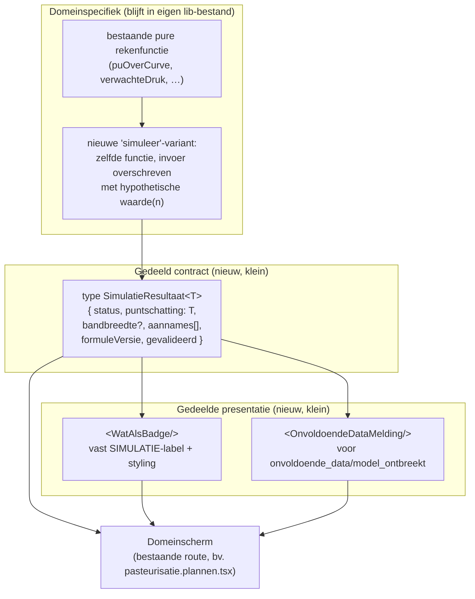

# Fase 21 — Wat-als-simulatielaag: architectuurontwerp

Status: **akkoord van Thomas op alle vier vragen, zie onderaan.** Dit
document is Fase 1 van de opdracht: nulmeting, weerwoord, en een
architectuurvoorstel. Geen code, geen schemawijzigingen — die volgen pas in
de aparte bouwsessie voor het pasteurisatie-domein (zie
`ONTWERP-SIMULATIE-2-PASTEURISATIE-PAD.md`).

> Naamgeving: dit document heette bij het schrijven nog "Fase 20", het
> eerstvolgende vrije nummer volgens deze sessie — maar dat nummer bleek
> inmiddels al gebruikt voor het EU-etiket/QR-werk. Thomas heeft "Fase 21"
> als het juiste nummer bevestigd, en gaf aan dat toekomstige documenten dit
> zelf horen te controleren tegen `WERKLOG.md` in plaats van te gokken —
> vandaar dat een volgende sessie het eerstvolgende vrije nummer zelf moet
> vaststellen, niet aannemen.

---

## 1a. Nulmeting

### Gistingsvoorspelling (`src/lib/gisting-verwachting.ts`, Fase 7 Blok F2)

- **Invoer**: alle `AnalysePunt`s (partij, datum, Oechsle) van álle partijen,
  plus een vooraf bepaalde `vergelijkbarePartijIds`-verzameling (zelfde gist,
  anders zelfde wijntype — die matching gebeurt in de aanroepende route,
  `kelder.partijen.$partijId.tsx:190-208`, niet in de rekenkern zelf).
- **Methode**: puur statistisch. Per vergelijkbare partij wordt de gemiddelde
  daling in °Oe/dag berekend tussen de eerste en laatste meting
  (`dalingVanPartij`), en die dalingen worden gemiddeld tot één
  `dalingPerDag`. Er zit **geen temperatuur, geen gistsoort-kinetiek, geen
  fysisch model** in — het is een lineaire extrapolatie van hoe het eerder
  ging bij vergelijkbare partijen, niet een voorspelling van hoe het
  _zou_ gaan bij een andere temperatuur.
- **Hoe ver vooruit**: precies zo ver als er al echte metingen van de huidige
  partij zijn (`verwachting` wordt alleen berekend op data-punten die al
  bestaan, om de achterstand/voorsprong te tonen — er is geen extrapolatie
  voorbij de laatste meting in de huidige code).
- **Hard-eis "geen voorspelling verzinnen bij te weinig data" (Fase 13)**:
  **geïmplementeerd en gecontroleerd**. Bij minder dan 2 bruikbare
  vergelijkbare partijen retourneert de functie `status:
"te_weinig_historie"` in plaats van een lijn (regel 57-59). De UI toont dat
  ook zo (`kelder.partijen.$partijId.tsx:1198`, "Verwachtingslijn: ...").
- **Zuiverheid**: **100% pure functie.** Geen enkele database-aanroep, geen
  `fetch`, geen `Date.now()`-achtige verborgen staat behalve de meegegeven
  datums zelf. Rechtstreeks Node-testbaar (en getest, zie `*.test.ts`).
- **Belangrijke consequentie voor deze fase**: de voorbeeldvraag uit de
  opdracht — _"wat als deze partij bij 16°C in plaats van 18°C doorgist"_ —
  **kan dit model vandaag niet beantwoorden**, met geen enkele
  simulatielaag ter wereld, omdat er domeinkennis ontbreekt: er bestaat
  nergens in de codebase een functie die temperatuur aan gistingssnelheid
  koppelt. Dat is geen tekortkoming van dit ontwerp — het is een
  ontbrekend _domeinmodel_, dat eerst apart gebouwd zou moeten worden
  (kinetiek/Arrhenius-achtige temperatuursafhankelijkheid, of op zijn minst
  een empirische correctiefactor). Zie 1b.2 hieronder voor wat dit betekent
  voor de haalbaarheid van deze fase.

### PU/drukveiligheid (`src/lib/pasteurisatie.ts` + `src/lib/drukveiligheid.ts`, Fase 17)

- **PU-opbouw** (`puOverCurve`): trapeziumintegratie van
  `10^((T-refTemp)/z)` over een reeks tijd/temperatuurmetingen. Puur, geen
  minimumdrempel ("geen PU-bijdrage stilzwijgend weglaten" is een expliciete
  regel — zie code-commentaar). `voorspelPuVerloop` extrapoleert vooruit
  **bij aanhoudend gelijkblijvende temperatuur** vanaf de laatste meting,
  en weigert expliciet te voorspellen zolang de temperatuur nog stijgt of
  bij te weinig metingen/te korte tijdspanne (`"Onvoldoende data"`,
  regel 223-243) — dezelfde hard-eis als bij gisting, hier onafhankelijk
  opnieuw geïmplementeerd.
- **Drukmodel** (`verwachteDruk`/`veiligheidsoordeel`): een gekoppeld
  CO2/thermische-uitzetting/waterdamp-massabalansmodel, **zuiver
  parametrisch** (flesinhoud, vulvolume, CO2-gehalte, temperaturen erin,
  druk eruit — geen enkele databaseaanroep). Retourneert zowel het
  "eerlijke" gekoppelde model als een **conservatieve bovengrens**, en het
  veiligheidsoordeel gebruikt altijd de bovengrens. **Elk resultaat draagt
  `gevalideerd: false`** tot een echte gemeten run dat bevestigt — dat vlag
  bestaat dus al exact in de vorm die deze simulatiefase nodig heeft.
- **Al bestaande primitieve "wat-als"-functionaliteit** — belangrijke
  vondst: `pasteurisatie.plannen.tsx:121-126` (`gevoeligheidsdata`) loopt nu
  al een temperatuurreeks (30-65°C in stappen van 5) door `verwachteDruk()`
  heen om te tonen hoe gevoelig de druk is voor de doeltemperatuur — dat IS
  in essentie al een parametersweep-simulatie, alleen ad-hoc, alleen voor
  één parameter, en niet generiek herbruikbaar buiten dit scherm.
- **Databaseleunend of puur?**: de rekenkernen zelf zijn 100% puur. De
  _aanroepende routes_ (`pasteurisatie.run.$runId.tsx`,
  `pasteurisatie.plannen.tsx`) halen data op via `useQuery` en geven die als
  gewone waarden door aan de pure functies binnen een `useMemo` — exact het
  patroon dat een simulatielaag nodig heeft. Er hoeft dus **niets ontward**
  te worden voor dit domein.

### GDD/fenologie (`src/lib/gdd.ts`, wijngaardmodule)

- **Berekening**: `GDD/dag = max(0, (Tmax+Tmin)/2 - 10°C)`, cumulatief
  vanaf 1 april. `fetchGdd()` haalt **historische** dagtemperaturen op bij
  Open-Meteo's archive-endpoint (dus geen weersverwachting — alleen wat al
  gemeten is, tot 1-2 dagen terug) en cachet per dag in localStorage.
  `huidigeGdd`/`gddOpDatum` zijn pure lookups op het resultaat.
- **Wordt er al iets met weersverwachting gedaan?** Ja, maar losstaand: er
  bestaat een apart, ouder OpenWeatherMap-gebaseerd modul (`src/lib/weer.ts`)
  met een 3-daagse verwachting (`fetchVerwachting`) — puur voor de
  weerkaart op de hub, **niet gekoppeld aan GDD of aan enige rijpheids- of
  fenologieberekening.** Er bestaat geen enkele functie die van "3 dagen
  extra zon" naar "verwachte extra rijping" redeneert.
- **Bestaat er al trendberekening over eerdere metingen?** Ja, maar niet
  live in de app: `scripts/bereken-inzichten.mjs` (Fase 3-tool, draait
  handmatig/wekelijks) berekent `fenologie_vergelijking` — per (ras,
  fenologiemoment) het dagverschil van dit seizoen t.o.v. het gemiddelde van
  eerdere seizoenen, met exact dezelfde eerlijkheidsregel als de andere twee
  modellen: _"geen eerdere seizoenen om mee te vergelijken"_ als er niets
  is om mee te vergelijken (`bereken-inzichten.mjs:342-346`). Dit is een
  **batchscript dat naar een `inzichten`-collectie schrijft**, geen
  interactieve, aanroepbare functie — voor hergebruik in een simulatielaag
  zou de kernberekening (regel 328-360) losgetrokken moeten worden van de
  PocketBase-schrijfactie eromheen. Klein werk, maar niet nul.
- **Consequentie, zelfde patroon als bij gisting**: _"wat gebeurt er met
  rij 12 als ik vijf dagen wacht met plukken"_ vereist een model dat GDD (of
  weersverwachting) omzet naar verwachte suikeropbouw/rijpheid — **dat
  model bestaat nergens in de codebase.** GDD zelf is alleen een
  warmtesom, geen rijpheidsvoorspeller.

### Weer/ziektemodule (markt-gap uit `docs/marktverkenning.md`)

**Niet gebouwd**, op de bestaande 3-daagse OpenWeatherMap-verwachting
(`weer.ts`) na — dat is puur presentatie op de hub, geen ziekterisicomodel
(geen Botrytis-/peronospora-drukberekening, geen spuitvenster-advies). Dit
bevestigt dat de marktonderzoek-aanbeveling op dit punt nog volledig open
staat; het raakt deze fase niet direct (het is geen "voorspelt de
toekomst"-model in de zin van dit document), maar is relevant voor 1b.5: als
dit model ooit gebouwd wordt, zal het dezelfde eerlijkheids-/
onvoldoende-data-regel moeten volgen als de andere drie.

### Samenvatting nulmeting

| Model         | Pure functie?                                              | Doet nu al forward-simulatie?                                                                   | Tijdschaal | "Te weinig data"-regel aanwezig?                  |
| ------------- | ---------------------------------------------------------- | ----------------------------------------------------------------------------------------------- | ---------- | ------------------------------------------------- |
| Gisting       | Ja, volledig                                               | Nee — extrapoleert alleen langs bestaande meetpunten, geen temperatuur-hendel                   | dagen      | Ja (`te_weinig_historie`)                         |
| PU/druk       | Ja, volledig                                               | **Ja** — `voorspelPuVerloop` extrapoleert vooruit; planner heeft al een ad-hoc temperatuursweep | minuten    | Ja ("Onvoldoende data", stijgende-temp-weigering) |
| GDD/fenologie | Ja (rekenkern), batchscript nog gekoppeld aan schrijfactie | Nee — sommeert alleen warmte, projecteert niets naar rijpheid                                   | weken      | Ja (`fenologie_vergelijking`, batchscript)        |

**Dit is de belangrijkste uitkomst van de nulmeting, en verandert het hele
weerwoord hieronder**: van de drie genoemde modellen is er maar **één**
(pasteurisatie) dat vandaag al doet wat de opdracht beschrijft — een
toestand een stap vooruit zetten onder een hypothetische ingreep. De andere
twee zijn _terugkijkende_ extrapolaties (vergelijk met het verleden) zonder
een hendel om aan te draaien voor het "wat als"-scenario uit de opdracht.
Om die vragen ooit echt te kunnen beantwoorden is niet in de eerste plaats
een simulatielaag nodig, maar **twee nieuwe domeinmodellen die vandaag niet
bestaan** (temperatuur→gistingssnelheid, GDD/weer→rijpingssnelheid).

---

## 1b. Weerwoord op de opdracht

### 1. Is één gedeelde abstractie hier zinnig?

**Nee, niet als gedeelde uitvoeringsmotor — wel als gedeelde
interfaceafspraak.** De drie domeinen delen op het eerste gezicht de vorm
"toestand + tijdstap + regel = nieuwe toestand", maar bij het uitschrijven
valt dat uiteen:

- **Tijdschaal loopt drie ordes van grootte uiteen** (minuten vs. dagen vs.
  weken) — een gedeelde "stap-motor" zou voor elk domein een ander
  tijdstapmechanisme nodig hebben, wat betekent dat de motor zelf niets
  gemeenschappelijks meer bevat behalve een naam.
- **De "regel" is fundamenteel ander soort ding per domein**: bij
  pasteurisatie is het een gesloten-vorm fysische formule (temperatuur →
  PU-snelheid, direct); bij gisting is het een **statistische extrapolatie
  over andere partijen** (geen fysisch model, geen directe temperatuur-
  hendel — zie nulmeting); bij GDD is het een **sommatie**, geen
  toestandsovergang met een regel die op de vorige toestand inwerkt. Deze
  drie "regels" een gemeenschappelijke handtekening `(toestand, stap) =>
toestand` opleggen zou de statistische en sommatie-modellen dwingen te
  doen alsof ze een stapsgewijze fysische simulatie zijn, terwijl ze dat
  niet zijn.
- Wat wél echt gedeeld is, en waar bij het bouwen niets van uiteenvalt:
  1. **Het resultaat-contract**: puntschatting + bandbreedte + aannames +
     een `gevalideerd`/`onvoldoende_data`/`model_ontbreekt`-status. Alle
     drie modellen produceren (of zouden moeten produceren) precies dit,
     en dat is precies wat de presentatielaag nodig heeft.
  2. **De eerlijkheidsregel**: nooit een lijn verzinnen bij te weinig
     historie — al drie keer onafhankelijk vanuit hetzelfde instinct
     gebouwd (gisting, PU, fenologie), dus kennelijk een architecturaal
     principe, geen toeval.
  3. **De presentatiegarantie**: een simulatie mag nooit op een echte
     meting lijken. Dat is een UI-regel, geen rekenregel, en dus
     domein-onafhankelijk te bouwen.

**Advies**: bouw een **lichte, gedeelde interfaceafspraak** (een
TypeScript-type + een klein aantal presentatie-componenten/conventies), géén
gedeelde uitvoeringsmotor. Zie 1c.

### 2. Is de eerste-stap-beperking (alleen pasteurisatie) verstandig?

**Ja — sterker nog, verstandiger dan de opdracht zelf veronderstelt.** De
opdracht framet dit als een voorzichtige beperking ("het domein waar de
rekenmodellen het verst uitgewerkt zijn"). De nulmeting laat zien dat het
eigenlijk de **enige haalbare eerste stap** is: pasteurisatie is het enige
domein waar een echt forward-simulatie-model al bestaat. Gisting en GDD
hebben geen tijdstap-vooruit-model — die zouden voor "wat als"-vragen eerst
een nieuw domeinmodel nodig hebben, wat compleet losstaat van welke
simulatielaag je eromheen bouwt.

**Ondermijnt dat het punt van een gedeelde laag?** Gedeeltelijk, en dat moet
eerlijk benoemd worden: één domein bewijst niet dat een _generieke
uitvoeringsmotor_ voor drie tijdschalen werkt — maar dat is precies waarom
1b.1 al afraadt zo'n motor nu te bouwen. Wat één domein wél kan bewijzen: of
het resultaat-contract en de presentatieconventie (band, status, "SIMULATIE"-
label) in de praktijk bruikbaar zijn voor een echte gebruiker. Dat is het
enige deel van "de laag" dat nu zinvol te valideren is, en dat is ook het
enige deel dat nu gebouwd zou moeten worden.

**Eerlijke waarschuwing dat wél serieus genomen moet worden**: als over een
paar maanden geprobeerd wordt gisting toe te voegen, en blijkt dat het
"lichte contract" toch net niet past (bijvoorbeeld: gisting heeft een heel
andere vorm van onzekerheid — spreiding tussen partijen, niet een numerieke
band rond één curve), dan is dát het signaal om de aanpak uit 1b te
heroverwegen — niet een falen van deze fase, maar precies het soort
informatie dat je pas na een tweede domein krijgt. Zie 1c, laatste punt.

### 3. Wat is de kleinste bruikbare versie?

**De "eigen simuleer-knop per scherm"-aanpak levert waarschijnlijk al 80%
van de waarde** — en dat is niet hypothetisch, want die aanpak **bestaat al
in dit project**: de temperatuursweep in `pasteurisatie.plannen.tsx`
(`gevoeligheidsdata`) is precies dat patroon, ad-hoc gebouwd, zonder
gedeelde infrastructuur, en werkt kennelijk goed genoeg om al in productie
te staan.

Wat dat ad-hoc patroon **niet** geeft, en waar de extra complexiteit van een
(lichte) gedeelde laag wél waarde toevoegt:

- **Consistentie in hoe een gebruiker een simulatie herkent.** Zonder
  gedeelde conventie bedenkt elk scherm zijn eigen manier om "dit is een
  aanname, geen meting" te laten zien — met risico dat het ene scherm dat
  duidelijker doet dan het andere (en de harde eis in de opdracht is nu
  juist dat een gebruiker dit _nooit_ mag verwarren met een meting).
- **Eén plek om de eerlijkheidsregel te controleren** in plaats van hem
  drie keer apart te moeten onthouden (wat nu al is gebeurd — drie
  onafhankelijke implementaties van dezelfde regel is een teken dat een
  gedeeld stukje logica hem beter bewaakt dan een geheugensteun per
  ontwikkelsessie).

**Op deze schaal (één bedrijf, één hoofdgebruiker, misschien een paar
medewerkers) weegt dat verschil niet op tegen een zware architectuur.** Het
weegt wel op tegen **een paar gedeelde TypeScript-types en één klein UI-
component** (zie 1c). Advies: bouw het lichte contract, sla de motor over.

### 4. Verklaarbaarheid onder samengestelde simulaties

**Sta het niet toe in de eerste versie.** Een gebruiker die "wat als ik vijf
dagen wacht met plukken" combineert met "en wat als de gisting dan bij deze
temperatuur gebeurt" stapelt twee compleet verschillende soorten
onzekerheid op elkaar: een (nog te bouwen) rijpingsmodel met eigen
foutmarge, gevolgd door een extrapolatie over historische partijen met een
eigen, andere foutmarge. Een enkel getal aan het eind van die keten oogt
preciezer dan het is — precies het "vals gevoel van precisie" waar de
opdracht terecht voor waarschuwt.

**Concreet ontwerpvoorstel**: de UI mag een simulatie-uitkomst nooit als
invoer voor een tweede simulatie aanbieden in v1. Elke "wat als"-vraag
staat op zichzelf, met zijn eigen bandbreedte, en wordt nooit stilzwijgend
gekoppeld. Mocht Thomas expliciet kettingsimulaties willen (en dat is
denkbaar, het is een natuurlijke vraag), dan is het juiste antwoord niet "een
getal met een bredere band", maar een UI die zegt: _"Dit combineert twee
aannames met verschillende betrouwbaarheid — resultaat getoond als
richting, niet als getal"_ (bijvoorbeeld alleen "vroeger/later/ongeveer
gelijk" in plaats van een dagen-cijfer). Dat is een aparte, bewuste
beslissing voor als de behoefte zich aandient — niet iets om nu vast te
bouwen.

### 5. Data-eerlijkheid

Elk van de drie bestaande modellen implementeert al **een** vorm van "zeg
eerlijk dat er te weinig data is" — maar geen enkele onderscheidt momenteel
tussen twee heel verschillende situaties:

- **"Te weinig data"**: het model bestaat en is geschikt, maar er zijn nog
  niet genoeg metingen/seizoenen om het te voeden (dit is wat de drie
  bestaande statussen nu al dekken).
- **"Model ontbreekt"**: er is geen enkele hoeveelheid data die zou helpen,
  omdat de rekenkundige relatie zelf nog niet geschreven is (dit is de
  situatie voor de temperatuur→gistingssnelheid- en
  GDD→rijpheid-vragen uit de nulmeting — geen hoeveelheid metingen lost dat
  op, er moet eerst een formule bij komen).

**Ontwerpvoorstel**: het gedeelde resultaat-contract (1c) moet dit
onderscheid expliciet maken, met een derde status naast de bestaande twee
patronen (`ok` / `onvoldoende_data` / **`model_ontbreekt`**). Voor
pasteurisatie is dit vandaag niet relevant (het model bestaat en de app
heeft al genoeg data-typen); voor gisting/GDD is dit cruciaal zodra iemand
"wat als bij een andere temperatuur" probeert vóór dat domeinmodel bestaat —
de simulatielaag moet dan letterlijk zeggen _"deze wat-als-vraag kan (nog)
niet beantwoord worden — er bestaat geen temperatuurmodel voor gisting"_ in
plaats van te doen alsof de bestaande historie-extrapolatie een antwoord op
een temperatuurvraag is (wat het niet is — die extrapolatie weet niet eens
dat er een temperatuur is).

---

## 1c. Architectuur — lichte interfaceafspraak, geen gedeelde motor

Op basis van 1b: geen "SimulatieMotor"-klasse die alle domeinen aanstuurt.
In plaats daarvan drie kleine, onafhankelijke onderdelen die elk domein
gebruikt, zonder dat een domein weet van de andere twee:

### Toestandsrepresentatie

**Rechtstreeks uit bestaande collecties lezen, geen snapshot-kopie.** Dit
sluit aan bij wat er al gebeurt: elke route haalt actuele data op via
`useQuery`/de bestaande `fetch*`-functies in `*-data.ts`, en geeft die als
gewone waarden door aan de pure rekenfunctie. Een "wat als"-variant doet
precies hetzelfde, met één of meer velden overschreven door de
hypothetische waarde vlak vóór de aanroep — bijvoorbeeld: haal de echte
temperatuurcurve van een lopende pasteurisatierun op, en bouw daarna een
tweede reeks waarin de laatste N metingen zijn vervangen door een
hypothetische vervolgcurve bij een andere doeltemperatuur. Geen nieuwe
collectie, geen "simulatie_staat"-tabel, geen verversingsrisico — de
simulatie is per definitie zo actueel als de laatste keer dat de pagina de
echte data ophaalde.

**Verworpen alternatief**: een aparte snapshot-collectie die de
toestand op een moment bevriest. Sneller misschien, maar voegt een
synchronisatieprobleem toe (welke snapshot hoort nog bij de werkelijkheid?)
voor een schaal (één gebruiker, interactief gebruik binnen één
scherm-sessie) waar dat probleem niet bestaat.

### Zuiverheid

**Grotendeels al in orde — geen grote herstructurering nodig.** De
nulmeting bevestigt dat alle drie rekenkernen (`gisting-verwachting.ts`,
`pasteurisatie.ts`, `drukveiligheid.ts`) vandaag al 100% puur zijn: geen
enkele databaseaanroep zit erin, alle I/O gebeurt al in de aanroepende
route. Het enige onderdeel dat nog ontward moet worden is
`berekenFenologieVergelijking()` in `scripts/bereken-inzichten.mjs`, die nu
direct na de berekening naar PocketBase schrijft — de kernberekening
(regel 328-360) moet uit die functie getild worden naar een losse,
export­bare pure functie voordat GDD/fenologie ooit in de simulatielaag
past. Klein, geïsoleerd werk, niet urgent voor de pasteurisatie-eerste-stap.

### Presentatie (harde eis)

Drie regels, gedwongen via één klein gedeeld component in plaats van
per-scherm-discipline:

1. Een simulatie-uitkomst staat **altijd visueel gescheiden** van echte
   metingen — nooit in dezelfde lijn/kaart, wel ernaast of als duidelijk
   andere stijl (stippellijn/andere kleur — het bestaande patroon
   "Verwacht (historie)" in `kelder.partijen.$partijId.tsx:1151-1152` is
   hier het te volgen precedent, niet iets nieuws te verzinnen).
2. Een vast, altijd zichtbaar label — niet alleen in een tooltip — met de
   tekst "SIMULATIE — geen meting" of gelijkwaardig, via één gedeeld
   `<WatAlsBadge/>`-component zodat de bewoording niet per scherm gaat
   afwijken.
3. Een simulatie overschrijft nooit de echte-datastaat in de UI (geen
   "even net doen alsof" dat blijft hangen na het sluiten van het
   wat-als-paneel) — technisch geborgd doordat de simulatie-invoer altijd
   een kopie is die apart wordt doorgegeven aan een apart deel van het
   scherm, nooit terugschrijft naar de React Query-cache van de echte data.

### Onzekerheid

Geen universele formule voor de band — per domein anders, maar met een
gedeeld weergave-idee (`ondergrens`/`bovengrens` of `±`):

- **Pasteurisatie/druk**: **bestaat al, hergebruiken**. `drukGaugeBar`
  (gekoppeld model) en `drukGaugeBovengrensBar` (conservatief) vormen samen
  al een impliciete band. Voor de PU-tijdsvoorspelling kan de band groeien
  met de extrapolatie-afstand (hoe verder voorbij de laatste meting, hoe
  breder — bijvoorbeeld ± een fractie van de resterende tijd).
  **Nul nieuw rekenwerk nodig** om dit te vullen, alleen de twee al
  bestaande getallen expliciet als band tonen in plaats van er stilzwijgend
  één van te kiezen.
- **Gisting**: de spreiding tussen de individuele `dalingen[]`-waarden (nu
  alleen gemiddeld tot `dalingPerDag`) geeft direct een band — min/max in
  plaats van alleen het gemiddelde. Klein, geïsoleerd toevoegwerk áls dit
  domein aan de beurt komt.
- **GDD**: geen bandbreedte-bron vandaag; zou moeten komen uit de spreiding
  tussen eerdere seizoenen in `fenologie_vergelijking`, of uit de
  onzekerheid van de weersverwachting zelf (Open-Meteo geeft geen
  betrouwbaarheidsinterval terug op het gratis endpoint) — nog een open
  vraag voor domein 3, niet nu op te lossen.

### Rol van AI

**Bevestigd, niet weersproken**: AI hoort in deze laag nergens de
rekenkern te vervangen. De enige plausibele rol is een latere,
losstaande stap — een agent-tool (in de bestaande Fase 3-registerstijl)
die een al-berekend `SimulatieResultaat`-object als context krijgt en
in gewone taal samenvat ("bij 16°C in plaats van 18°C duurt de gisting
naar schatting X dagen langer, gebaseerd op Y vergelijkbare partijen").
Dit hoort **niet** in de scope van de eerste (pasteurisatie-)bouwstap: de
UI-badge en het cijfer zijn zelf al de uitleg die een gebruiker nodig heeft
voor één parameter-sweep. AI-uitleg wordt pas de moeite waard bij een
samengestelde vraag — en samengestelde vragen worden juist in 1b.4
uitgesteld.

### Kosten (indien/wanneer AI-uitleg wordt toegevoegd)

Zelfde patroon als `ONTWERP-1-ARCHITECTUUR.md` §Kostenmodel. Uitgangspunt:
een uitleg-aanroep gebeurt **alleen op expliciet verzoek** (een
"leg dit uit"-knop bij een al berekend resultaat), nooit automatisch bij elke
schuifbalk-beweging in een parametersweep — dat laatste zou bij interactief
schuiven tientallen aanroepen per minuut kunnen genereren voor iets dat de
badge al toont.

| Aanroeptype                     | Tokens per aanroep (schatting)                            | Frequentie                                              | Model                                        | Kosten/maand (rustig) | Kosten/maand (pasteurisatieseizoen)                 |
| ------------------------------- | --------------------------------------------------------- | ------------------------------------------------------- | -------------------------------------------- | --------------------- | --------------------------------------------------- |
| "Leg dit wat-als-resultaat uit" | ~400 in (resultaat-JSON + korte systeemprompt) + ~150 uit | Op knopdruk, geschat een paar keer per pasteurisatierun | claude-sonnet-5 (zelfde als bestaande agent) | < €1                  | Enkele euro's, ruim onder de bestaande agent-kosten |

Dit is nadrukkelijk een **latere, optionele** uitbreiding — geen onderdeel
van de eerste bouwstap.

### Uitbreidbaarheid naar domein 2 en 3

- **Wat blijft hetzelfde**: het `SimulatieResultaat`-contract, de
  `<WatAlsBadge/>`/`<OnvoldoendeDataMelding/>`-componenten, de regel "nooit
  kettingsimulaties in v1".
- **Wat moet apart, vóór de simulatielaag zelf iets kan, gebouwd worden**:
  - **Gisting**: een nieuw temperatuur→snelheid-domeinmodel (bijvoorbeeld
    een empirische correctiefactor op `dalingPerDag`, gekalibreerd zodra er
    genoeg eigen data is — of eerlijk "model_ontbreekt" tot die er is).
  - **GDD/fenologie**: een nieuw GDD/weer→rijpheid-domeinmodel, én het
    lostrekken van `berekenFenologieVergelijking()` uit het batchscript
    (zie Zuiverheid hierboven).
- **Signaal om de aanpak uit 1b te heroverwegen**: als bij het bouwen van
  domein 2 blijkt dat `SimulatieResultaat` niet past — bijvoorbeeld omdat
  gisting's onzekerheid een compleet andere vorm heeft dan een simpele band
  (een verdeling over partijtypes, geen getal) — dan is dat het teken dat
  het "lichte contract" zelf op de schop moet, niet dat er alsnog een zware
  motor nodig is. Dat zou een aparte, kleine ontwerp-herziening zijn, geen
  reden om de pasteurisatie-implementatie over te doen.

---

## Drie belangrijkste ontwerpkeuzes

1. **Geen gedeelde uitvoeringsmotor — wel een gedeeld resultaat-contract en
   twee kleine UI-componenten.** De drie domeinen delen een presentatie- en
   eerlijkheidsprobleem, niet een rekenprobleem.
2. **Kettingsimulaties (samengestelde wat-als-vragen) worden in v1
   uitgesloten**, met een expliciete UI-weigering in plaats van een
   optelsom van onzekerheden die preciezer oogt dan hij is.
3. **Van de drie genoemde domeinen bestaat er vandaag maar één
   (pasteurisatie) dat al een forward-simulatiemodel heeft** — gisting en
   GDD hebben eerst een nieuw domeinmodel nodig (temperatuur→snelheid,
   respectievelijk GDD/weer→rijpheid) vóórdat welke simulatielaag dan ook
   iets voor die twee domeinen kan doen. Dat is geen reden om deze fase niet
   te doen, wel een reden om de scope van "domein 2 en 3" in Fase 2 van
   deze opdracht niet te onderschatten.

---

## Besluit van Thomas (5 september 2026)

Alle vier vragen beantwoord, akkoord op het volledige ontwerp:

1. **Fasenummer: 21.** Thomas bevestigt expliciet dat fasenummers die hij
   zelf in een opdracht noemt een gok zijn (zijn documenten hebben geen
   zicht op wat er tussentijds gebouwd is) — een volgende sessie moet het
   eerstvolgende vrije nummer zelf tegen `WERKLOG.md` controleren, niet
   aannemen wat in de opdracht staat.
2. **Bevestigd als de belangrijkste vondst van dit document.** Thomas geeft
   aan zelf te makkelijk over dit gat heen gestapt te zijn bij het schrijven
   van de opdracht — de voorbeeldvragen ("16°C i.p.v. 18°C", "vijf dagen
   wachten met plukken") veronderstelden modellen die niet bestaan. Besluit:
   **"wat als" blijft voorlopig beperkt tot pasteurisatie.** De twee
   ontbrekende domeinmodellen (temperatuur→gistingssnelheid,
   weer/GDD→rijpheid) worden **niet nu gebouwd**, met twee expliciete
   redenen van Thomas: (a) het temperatuur-gistingsmodel heeft echte data
   uit een gedraaid seizoen nodig — bouwen op aannames zou dezelfde fout
   herhalen als het losgelaten ijkpunt bij het drukmodel (Fase 17); (b) het
   rijpheidsmodel hoort bij dezelfde ontwerpbeurt als de weer/ziektemodule
   uit het marktonderzoek (ze delen dezelfde weerdata) en moet niet los
   daarvan worden voorgesorteerd. Beide worden als **toekomstig werk met
   randvoorwaarden** vastgelegd in Fase 2 hieronder, niet stilzwijgend
   losgelaten.
3. **Akkoord, en Thomas maakt dit sterker dan een tijdelijke beperking**:
   geen kettingsimulaties is een **ontwerpstandpunt**, niet een fase-1-
   compromis. Onzekerheden stapelen sneller dan mensen aanvoelen, en een
   gecombineerd antwoord oogt net zo stellig als een enkelvoudig antwoord —
   exact de schijnprecisie die niet onder een beslissing over springend
   glas of een plukmoment mag liggen. Mocht dit ooit terugkomen, dan alleen
   met zichtbaar bredere bandbreedtes, nooit als los toegevoegde nuance.
4. **Akkoord met de lichte aanpak** (gedeeld contract + twee
   UI-componenten, geen generieke motor) — mede omdat vraag 2 al vaststelt
   dat er voorlopig maar één domein is om hem op te gebruiken; een
   generieke motor bouwen voor één gebruiker en één werkend domein zou
   precies de overengineering zijn waar het weerwoord tegen waarschuwt.

**Twee expliciete opdrachten van Thomas voor Fase 2**: (1) leg het
ontbrekende temperatuur-gistingsmodel en het rijpheidsmodel vast als
toekomstig werk met randvoorwaarden (welke data eerst nodig is), zodat ze
niet uit beeld raken; (2) herhaal de openstaande drukvalidatie-waarschuwing
uit Fase 17 nadrukkelijk — dat blijft de zwakke plek in het enige domein dat
nu wél gebouwd wordt. Beide zijn verwerkt in
`ONTWERP-SIMULATIE-2-PASTEURISATIE-PAD.md`.
